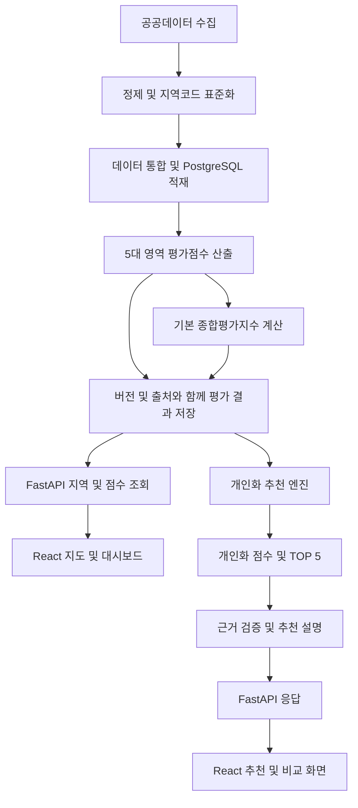
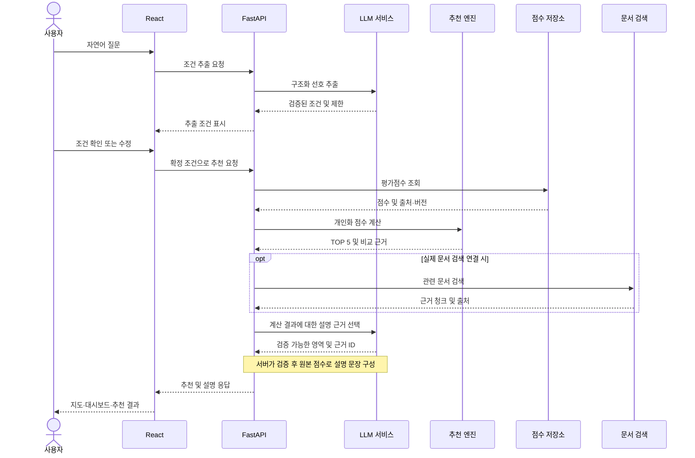

> ⚠️ 본 문서는 현재 개발 중인 프로젝트의 기획 및 설계 내용을 정리한 초안입니다. 프로젝트 진행 상황, 데이터 확보 여부, 팀원 간 협의 및 기술적 제약에 따라 일부 기능, 평가 기준, 시스템 구조, 역할 분담, 개발 일정 등이 추후 수정될 수 있습니다.

# AI 기반 도시 생활환경 평가 및 맞춤형 주거지역 추천 플랫폼

| 문서 정보 | 내용 |
|---|---|
| 작성·현황 확인일 | 2026년 10월 13일 |
| 문서 버전 | 초안 0.2 |
| 용도 | 팀의 기획·개발 방향 공유 및 통합 개발 기준 |
| 작성 근거 | 현재 논의 내용과 작업 폴더의 문서·소스 확인 |
| 상태 표기 | **개발 기준**: 현재 논의상 기준 / **구현 확인**: 소스에서 확인 / **구현 예정**: 계획 단계 / **검토 중·잠정**: 합의 또는 데이터 확인 필요 |

‘구현 확인’은 코드 존재와 동작 구조를 확인했다는 뜻이며, 실데이터 연동·외부 API 실환경 검증·배포 완료를 의미하지 않는다. 이 문서 작성 작업에서는 테스트를 재실행하지 않았으므로 기존 문서의 테스트 결과를 신규 검증 결과로 제시하지 않는다.

## 목차

1. [프로젝트 개요](#1-프로젝트-개요)
2. [프로젝트 목적](#2-프로젝트-목적)
3. [핵심 기능](#3-핵심-기능)
4. [5대 생활환경 평가 영역](#4-5대-생활환경-평가-영역)
5. [데이터 수집 및 정제](#5-데이터-수집-및-정제)
6. [평가모델 설계](#6-평가모델-설계)
7. [개인화 추천 시스템](#7-개인화-추천-시스템)
8. [LLM·RAG 설계](#8-llmrag-설계)
9. [백엔드 및 프론트엔드](#9-백엔드-및-프론트엔드)
10. [기술 스택](#10-기술-스택)
11. [팀원 역할 분담](#11-팀원-역할-분담)
12. [시스템 데이터 흐름](#12-시스템-데이터-흐름)
13. [개발 일정](#13-개발-일정)
14. [확정 사항 및 미확정 사항](#14-확정-사항-및-미확정-사항)
15. [향후 변경 가능성 및 문서 관리](#15-향후-변경-가능성-및-문서-관리)

## 1. 프로젝트 개요

| 항목 | 현재 계획 |
|---|---|
| 프로젝트명 | AI 기반 도시 생활환경 평가 및 맞춤형 주거지역 추천 플랫폼 — 변경 가능 |
| 유형 | AI·데이터 분석 기반 웹 서비스 |
| 개발 인원 | 총 7명 |
| 개발 기간 | 약 2주 |
| 목표 완료일 | 2026년 10월 23일 |
| 우선 분석 대상 | 서울특별시 25개 자치구 |
| 향후 확장 | 행정동 단위 분석 및 다른 지역 — 검토 중 |
| 서비스 구성 | 공공데이터 기반 평가, 개인화 추천, LLM 기반 조건 추출·설명, 지도·대시보드 |

### 기존 설계·구현과 현재 기획의 차이

기존 [ARCHITECTURE.md](ARCHITECTURE.md)는 **행정동을 조회·추천 단위로 설정한 구현 전 설계안**이다. 이번 논의는 **서울시 25개 자치구 우선 분석**을 개발 기준으로 한다. 공간 단위에 관한 두 문서의 기준이 다르므로 API·지도·데이터 계약을 통합하기 전에 팀이 자치구 우선 기준을 확인해야 한다. 기존 문서는 이번 작업에서 수정하지 않았다.

현재 구현된 추천 모듈은 `district`, `administrative_dong`, `unknown` 공간 단위를 구분한다. 따라서 자치구 점수 입력을 받을 수 있는 계약은 있지만, 실제 자치구 25개 데이터가 연결된 상태는 아니다. `mock_data.py`는 7개 **가상 행정동**의 합성 점수이며 서울시 실제 통계나 실제 지역 목록이 아니다. 자치구 중심 통합 개발에는 별도의 자치구 Mock 및 실제 데이터 준비가 필요하다.

현재 [README.md](README.md)는 추천·LLM 모듈의 사용법과 제약을 설명한다. 전체 플랫폼 구현 완료를 뜻하지 않으며, 기존 설계 문서의 예정 디렉터리 구조도 실제 파일 목록과 구분해야 한다.

## 2. 프로젝트 목적

서울시 공공데이터를 수집·정제·통합하여 지역별 생활환경을 비교 가능한 지표로 평가하는 플랫폼을 개발한다. 사용자는 경제·에너지·쾌적·건강·치안 정보를 살펴보고, 중요하게 생각하는 영역에 따라 주거지역을 추천받도록 한다.

LLM은 자연어로 표현한 선호를 구조화하고 계산된 추천 결과의 근거를 설명한다. 평가 결과는 선정 지표·기준연도·정규화·가중치에 영향을 받으므로, 지역의 절대적인 우열이나 미래 생활환경을 보장하는 수치로 표현하지 않는다. 출처와 평가 기준을 함께 제공하는 것을 목표로 한다.

## 3. 핵심 기능

| 기능 | 계획 및 제공 내용 | 현재 저장소 상태 |
|---|---|---|
| 서울시 생활환경 지도 | 자치구별 점수와 지역 정보 표시 | 구현 예정; 지도 UI·경계 데이터 미확인 |
| 5대 영역 대시보드 | 영역별 0~100점 및 기본 종합평가지수 | 점수 입력 계약 구현 확인; 원자료 기반 점수 산출·화면 구현 예정 |
| 개인화 추천 | 선호 가중치, 조건 필터, TOP 5 | Python 추천 함수 구현 확인; API·UI 연동 예정 |
| 지역 비교 | 영역 점수 및 차이 비교 | 비교 함수 구현 확인; 비교 화면 예정 |
| 자연어 추천 | 조건 추출, 선호 확인·수정, 추천 계산 | 추출·계산 파이프라인 구현 확인; 사용자 확인 UI 예정 |
| 추천 설명 | 점수에 근거한 장단점과 출처 표시 | LLM 근거 선택·서버 문장 구성 구현 확인; 실환경 검증 상태 별도 확인 필요 |
| 문서 근거 검색 | 실제 설명서·지표 정의서 기반 RAG | 검색 인터페이스만 구현 확인; 실제 문서·벡터 검색 미구현 |

## 4. 5대 생활환경 평가 영역

다음 영문 키를 정제 데이터, 평가·추천 모듈, API, 프론트엔드에서 공통으로 사용한다. 모든 영역은 **점수가 높을수록 생활환경이 양호한 0~100점**으로 설계한다.

| 공통 키 | 한글 명칭 | 주요 평가 내용 — 지표 후보 |
|---|---|---|
| `economy` | 경제 활성도 | 인구, 사업체, 상권, 소득, 고용 |
| `energy` | 에너지 효율성 | 전력·가스 사용량, 에너지 효율 |
| `comfort` | 생활 쾌적도 | 미세먼지, 기온, 습도, 소음 |
| `health` | 건강·의료 안전성 | 병원, 보건소, 의료 접근성 |
| `safety` | 치안 안전도 | 범죄 발생률, CCTV, 경찰시설 |

위 내용은 확보가 확인된 지표 목록이 아니다. 실제 사용 지표·단위·방향성·집계 방법은 데이터 확보 후 검토한다. 예를 들어 에너지 사용량이 적다는 이유만으로 효율성이 높다고 단정하지 않으며 인구·가구·건물 등 적절한 기준을 검토한다. 시설 수와 접근성도 동일한 지표로 취급하지 않는다.

## 5. 데이터 수집 및 정제

### 수집 대상과 출처 기록

서울열린데이터광장, 공공데이터포털 등의 공공데이터를 우선 검토한다. 현재 확인한 작업 폴더에는 실제 공공데이터 원본·정제 CSV·ETL 구현이 없으므로 특정 데이터셋 확보 완료를 주장하지 않는다.

수집 담당자는 데이터셋 제목, 제공기관, 원문 URL 또는 식별자, 기준연도·기간, 수집일, 원본 공간 단위, 단위, 이용조건을 기록한다. 영역 간 연도가 다르면 이를 표시하고 비교 가능성을 검토한다.

### 공통 정제 규칙

| 항목 | 개발 기준 |
|---|---|
| 영역 | `economy`, `energy`, `comfort`, `health`, `safety` |
| 지역 식별자 | 문자열 `region_code`; 코드 체계·행정구역 기준시점은 팀 협의 필요 |
| 지역명 | `region_name` |
| 기준연도 | `year`; 원자료의 기준연도 의미를 유지 |
| 개별 지표 | `crime_count`, `cctv_count` 등 의미가 명확한 영문 컬럼명 |
| 원본 보관 | 원본과 정제 데이터를 분리하여 재현 가능하게 보관 |
| 검증 | 결측치, 중복, 지역코드 불일치, 단위·자료형·범위 확인 |
| 공간 단위 | 원본 단위와 서비스 단위를 명시하고 변환·집계 근거 기록 |

결측치를 임의로 0으로 채우지 않는다. 제외·대체·추가 수집 여부와 이상치 처리 규칙은 평가 담당자와 협의하여 기록한다. 건수 지표를 인구당 비율 등으로 변환한다면 분모와 기준연도를 함께 관리한다.

```text
# 정제 파일명 예시 — 실제 파일이 아니며 확보 연도에 따라 변경 가능
economy_2024.csv
energy_2024.csv
comfort_2024.csv
health_2024.csv
safety_2024.csv
```

**자치구 통계를 행정동의 실제 관측값처럼 복사하거나 표시하지 않는다.** 향후 행정동 분석에는 해당 단위 데이터 또는 검증된 별도 추정 방법이 필요하며, 추정값이라면 관측값과 구분한다.

### 기존 추천 모듈과의 연결

정제 데이터의 `year`와 현재 추천 모듈 출처 메타데이터의 `reference_year`는 계층이 다르다. ETL·평가 결과를 추천 입력으로 변환할 때 기준연도를 출처별로 연결해야 한다.

현재 `RegionScore` 계약은 `region_code`, `region_name`, `category_scores`, `spatial_unit`, `score_version`, `sources`, `is_mock`을 사용한다. 각 출처에는 `source`, `document_title`, `reference_year`, `original_spatial_unit`, `is_mock`이 있다. 실제 연동에서는 이 정보를 명시적으로 제공하며, DB 테이블 구조는 아직 확정하지 않는다.

## 6. 평가모델 설계

정제된 지표를 정규화하고 가중합하여 영역별 점수를 계산하는 **통계적 정규화·가중치 기반 평가모델**을 계획한다. 별도의 학습·성능 검증 없이 머신러닝 예측모델이라고 표현하지 않는다. 학습용 정답 데이터가 확보되면 머신러닝 도입을 추가 검토한다.

| 단계 | 주요 작업 | 합의·검증 사항 |
|---|---|---|
| 1 | 영역별 지표 선정 | 확보 가능성, 의미, 중복 정보 |
| 2 | 방향성 결정 | 값이 클수록 양호한지, 작을수록 양호한지 |
| 3 | 정규화 | 기준 집단·연도, 결측·이상치, 동일 값 처리 |
| 4 | 영역 내부 가중치 설정 | 근거와 합계, 민감도 |
| 5 | 영역별 0~100점 산출 | 점수 범위와 방향성 일관성 |
| 6 | 기본 종합평가지수 계산 | 우선 동일 비중 검토 |
| 7 | 타당성 검증 | 분포, 특정 지표 편중, 가중치 변화에 따른 순위 |

아래 식은 **검토용 설계 예시**이며 구현 완료된 정규화 정책이 아니다.

```text
양의 방향 지표: z = (x - 최솟값) / (최댓값 - 최솟값)
음의 방향 지표: z = (최댓값 - x) / (최댓값 - 최솟값)
영역 점수 S[d] = 100 × Σ(영역 내부 가중치 a[d,j] × z[d,j])
  a[d,j] ≥ 0, 영역 내 가중치 합계 = 1

기본 종합평가지수 B = Σ(b[d] × S[d])
  우선 검토안: 5개 영역의 b[d] = 0.2
```

최댓값과 최솟값이 같을 때의 처리, 정규화 범위, 이상치 처리 및 영역 점수의 결측 정책은 미확정이다. 정책과 데이터 버전을 기록하여 서로 다른 산출 기준의 점수를 같은 순위에 혼합하지 않도록 한다.

현재 추천 모듈은 이미 산출된 0~100점 입력을 검증·통합한다. **원자료 → 정규화 → 5대 영역 점수**를 생성하는 평가 파이프라인은 현재 작업 폴더에서 확인되지 않았다. 동일 가중치 계산 함수를 활용할 수 있더라도 기본 지수의 저장·API 제공이 완료된 것은 아니다.

## 7. 개인화 추천 시스템

사용자가 중요하게 생각하는 5대 영역 가중치를 정규화하여 개인화 종합점수를 계산한다. 기본 종합평가지수는 공통 평가 기준이며, 개인화 점수는 사용자 선호에 따른 별도 결과다. 가중치가 같아 두 값이 일치하더라도 의미를 구분한다.

```text
사용자 가중치 w[d] ≥ 0, Σw[d] > 0
정규화 가중치 p[d] = w[d] / Σw[d]
개인화 종합점수 P[r] = Σ(p[d] × S[r,d])
조건 충족 지역을 점수 내림차순 정렬 → TOP 5
```

### 현재 구현 확인 사항

- `normalize_weights()`, `calculate_total_score()`, `recommend_regions()`, `compare_regions()`가 구현되어 있다.
- 점수는 유한한 0~100 숫자이며 결측은 `None`으로 구분한다. 가중치 합계 0은 오류다.
- 현재 생략한 가중치 키의 기본값은 1이다. 영역을 제외하려면 명시적으로 0을 입력한다.
- 양수 가중치 또는 최저점수 조건에 필요한 영역 점수가 결측이면 해당 지역을 제외한다. 지역별로 가중치를 다시 정규화하지 않는다.
- 반올림 전 점수 내림차순으로 정렬하고 동점은 `region_code` 문자열 오름차순으로 처리한다.
- `top_k`는 1~5이며 조건에 맞는 후보가 부족하면 가능한 수만 반환한다.
- 중복 지역코드, 공간 단위·점수 버전 혼합을 거부한다.
- 장단점은 지역 내부 영역 점수의 상대적 상위·하위 2개이며 실제 범죄·대기질 사실을 단정하지 않는다. 가중 기여도도 별도로 반환한다.
- 비교는 1~5개 지역에 대해 첫 지역 대비 영역 점수 차이를 제공한다.

제품의 추천 순위는 평가점수와 Python 계산으로 결정한다. **LLM은 순위를 임의로 생성하거나 변경하지 않는다.** 현재 지원하는 조건은 영역 가중치·영역별 최저점수 중심이며 월세·통근 시간 등 추가 조건은 데이터·알고리즘 확보 후 검토한다.

## 8. LLM·RAG 설계

추천 시스템과 LLM·RAG는 동일 담당자가 개발한다. OpenRouter API를 우선 검토하며, 현재 저장소에는 HTTPX 기반 클라이언트와 Pydantic 구조화 출력 검증 코드가 있다. 외부 서비스의 실환경 성공 여부는 소스 존재만으로 판단하지 않는다.

### 자연어 추천 처리

1. 사용자의 자연어 질문을 받아 선호 영역·가중치·지원 조건을 추출한다.
2. Pydantic 모델로 JSON을 검증하고 미지원 조건과 제한을 표시한다.
3. 추출한 선호를 사용자에게 보여주고 확인·수정할 수 있도록 한다 — 제품 UI 구현 예정.
4. 확정된 조건으로 추천 엔진을 호출해 점수와 순위를 계산한다.
5. 실제 문서가 연결되었다면 관련 근거를 검색한다.
6. 검증된 추천 결과와 근거로 설명을 구성한다.

현재 `answer_question()`은 추출 직후 **잠정 추천**을 계산하며 `needs_confirmation`을 유지한다. 실제 사용자 확인 절차는 백엔드·프론트엔드에서 연결해야 한다.

현재 숫자 비중 없는 명확한 선호는 선호 영역 3·나머지 1의 고정 정책을 적용하고, 모호한 요청은 동일 가중치를 사용한다. 이는 현재 코드의 정책으로 향후 팀 협의에 따라 변경 가능하다. 미지원 조건을 적용한 것처럼 설명하지 않는다.

### 설명 생성과 오류 처리

현재 설명 구현은 LLM이 설명할 영역과 실제 검색 근거의 ID를 선택하고, 서버가 이를 검증하여 원본 점수로 문장을 구성한다. 자유 서술로 새로운 통계를 덧붙이는 방식과 차이가 있다. 순위·점수·출처·기준연도·공간 단위·평가 버전을 보존한다.

추출 실패는 기본적으로 오류를 전달한다. 명시적인 대체 옵션을 사용한 경우 동일 가중치를 적용하고 질문 조건이 반영되지 않았음을 표시한다. 설명 실패는 계산 결과를 유지하면서 점수 기반 대체 문장을 제공한다. API 키는 서버 환경변수로 관리하고 브라우저에 전달하지 않는다.

### 선택적 RAG

실제 공공데이터 설명서·지표 정의서가 확보되면 문서 검증 → 본문 로딩 → 청크 분할 → 출처 메타데이터 부착 → 임베딩·색인 → 검색 연결을 검토한다. LangChain, ChromaDB, HuggingFace Embeddings는 필요성에 따라 선택한다.

현재 `EvidenceRetriever` 검색 인터페이스와 결과 검증만 구현되어 있다. 실제 문서 적재, 임베딩, 벡터 DB 검색은 미구현이다. 공급자나 검색 결과가 없으면 다음 상태를 반환하며 가짜 문서를 생성하지 않는다.

```json
{"status": "no_evidence", "chunks": []}
```

문서 근거 없음은 LLM 장애와 별개다. 실제 검색 공급자의 오류도 근거 없음으로 숨기지 않는다. 문서별 출처·제목·기준연도·지역 범위와 청크 식별자를 보존한다.

## 9. 백엔드 및 프론트엔드

### 백엔드 — 구현 예정

FastAPI 기반 REST API 서버를 구축하고 PostgreSQL 조회, 평가 결과, 추천·LLM 모듈을 연결한다. 요청·응답 검증, 오류 처리, API 문서화, 프론트엔드 통신을 담당한다. DB 준비 전에는 Mock 데이터로 개발한다.

| 예상 API | 용도 |
|---|---|
| `GET /api/health` | 서버 상태 확인 — 건강 영역 점수와 구분 |
| `GET /api/regions` | 지역 목록 조회 |
| `GET /api/regions/{region_code}` | 지역 상세 조회 |
| `GET /api/regions/{region_code}/scores` | 영역 점수 및 평가 메타데이터 조회 |
| `POST /api/compare` | 지역 비교 |
| `POST /api/recommend` | 선호 가중치 기반 추천 |
| `POST /api/chat` | 자연어 조건 추출·추천·설명 |

위 경로와 요청·응답 형식은 **검토 중**이며 현재 실행 가능한 엔드포인트가 아니다. 현재 Python 서비스 모델을 참고해 API 계약을 합의하고, 예외를 HTTP 상태와 일관된 오류 응답으로 변환해야 한다. PostgreSQL 스키마·SQLAlchemy 연동·마이그레이션도 구현 예정이다.

### 프론트엔드 — 구현 예정

React·TypeScript 기반으로 다음 화면을 계획한다.

| 화면 | 주요 내용 |
|---|---|
| 서울시 생활환경 지도 | 자치구 경계와 점수, 선택 지역 상세 |
| 평가 대시보드 | 5대 점수, 기본 종합평가지수, 출처·연도 |
| 지역 비교 | 영역별 비교 차트와 표 |
| AI 추천·채팅 | 가중치 입력, 자연어 조건 확인·수정, TOP 5와 설명 |

Vite, Tailwind CSS, Leaflet 또는 React-Leaflet, Recharts, Axios를 검토한다. 모바일에서도 사용할 수 있도록 반응형 UI를 고려한다. Mock 표시, 결측, 후보 부족, 미지원 조건, 근거 없음 및 외부 API 오류 상태를 화면에 반영할 예정이다.

## 10. 기술 스택

| 구분 | 예상 기술 | 현재 확인 또는 결정 상태 |
|---|---|---|
| 언어 | Python, TypeScript | Python 모듈 존재; TypeScript 예정 |
| 데이터 | Pandas, NumPy, GeoPandas | Pandas·NumPy 추천 코드 사용; ETL·GeoPandas 예정 |
| DB | PostgreSQL, SQLAlchemy | 구현 예정; 스키마 미확정 |
| 평가 | 통계적 정규화, 가중치 기반 모델 | 원자료 기반 평가 구현 예정 |
| 추천 | Python 가중치 추천 | 구현 확인 |
| LLM | OpenRouter API, Pydantic, HTTPX | 연동·검증 코드 구현 확인; 실환경 검증 별도 필요 |
| RAG | LangChain, ChromaDB, HuggingFace Embeddings | 선택 적용; 실제 검색 미구현 |
| 백엔드 | FastAPI, Uvicorn | 구현 예정 |
| 프론트엔드 | React, TypeScript, Vite, Tailwind CSS, React-Leaflet, Recharts, Axios | 구현 예정; 라이브러리 선택 변경 가능 |
| 배포 | Docker, Docker Compose | 구현 예정; 배포 환경 검토 중 |
| 테스트·CI | Pytest, CI 도구 미정 | 추천·LLM·RAG·파이프라인 테스트 파일 존재; 전체 웹 통합·CI 예정 |

현재 `requirements-ai.txt`는 Python 3.11 이상을 전제로 Pydantic, HTTPX, NumPy, Pandas, Pytest를 지정한다. 전체 플랫폼 의존성 파일로 간주하지 않는다. 최종 라이브러리·버전은 호환성과 일정에 따라 조정한다.

## 11. 팀원 역할 분담

총 7명이며 개인별 이름과 세부 소유권은 아직 정해진 것으로 간주하지 않는다. 초기에는 5명이 각 영역 데이터 수집·정제를 병행하고 이후 개발 역할로 전환한다. 영역별 수집 담당자 매핑은 별도 합의가 필요하다.

| 역할 | 주요 업무 | 주요 협업·인계 대상 |
|---|---|---|
| 1. 데이터 엔지니어 | 데이터 통합, 지역코드 표준화, ETL, DB 스키마·적재 | 평가 담당자에 정제 지표·출처 인계; 백엔드와 조회 계약 협의 |
| 2. AI·평가모델 개발자 | 지표·방향성·정규화·가중치 설계, 영역 점수·기본 지수, 결과 검증 | 추천 담당자에 점수·버전·결측 정책 인계 |
| 3. 추천 시스템·LLM·RAG 개발자 | 개인화 추천, 자연어 조건 추출, 설명, 선택적 RAG | 백엔드와 서비스 계약; 프론트와 선호 확인 흐름 협의 |
| 4. 백엔드 개발자 | FastAPI, REST API, DB·서비스 연동, 요청·응답 검증 | 데이터·추천·프론트 담당자 연결 |
| 5. 프론트엔드 개발자 | React UI, 지도, 대시보드, 비교·추천·채팅 | 백엔드와 API·Mock 응답 계약 협의 |
| 6. DevOps·QA 개발자 | Docker, 배포, CI, 통합 테스트, 오류·로그 관리 | 팀 전체와 실행·테스트·배포 기준 협의 |

각 개발자는 자기 모듈 검증을 담당하고 QA는 통합 품질을 지원하는 방식으로 검토한다. 역할·인수인계 범위는 일정과 작업량에 따라 변경 가능하다.

## 12. 시스템 데이터 흐름

아래는 **목표 구조**다. 전체 흐름이 현재 구현된 것은 아니다. 공공데이터 평가를 위한 배치 처리와 사용자 요청 시 추천 계산을 구분한다.



자연어 요청의 목표 흐름은 다음과 같다. 명시적인 가중치 입력은 LLM 조건 추출 없이 추천 엔진으로 전달할 수 있다.



현재 구현 범위는 `services/ai_recommendation/`의 **점수 입력 → 조건 추출 → 추천 계산 → 선택적 근거 검색 인터페이스 → 설명 → 결과 모델**이다. FastAPI, PostgreSQL, 사용자 확인 UI, 실제 문서 검색은 이후 연결해야 한다. 조건 확인 단계의 API 분리 여부는 검토 중이다.

## 13. 개발 일정

모든 날짜는 **2026년** 기준의 계획이며 진행 상황에 따라 조정한다. 기존 모듈을 재사용하되 자치구 단위 계약과 실제 데이터 연동을 우선 확인한다.

| 기간 | 주요 작업 | 확인할 산출물·완료 기준 |
|---|---|---|
| 10월 13~14일 | 데이터 정제, 공통 스키마 확정, 기능별 기본 코드 | 영역 키·지역 단위·결측·출처 계약, 자치구 Mock 준비 |
| 10월 15~16일 | 데이터 통합, 평가모델, 추천 및 기본 API | 점수 산출 재현, 기본 지수·추천 구분, Mock API 연동 |
| 10월 19~20일 | 실제 데이터 연동 및 프론트 통합 | 데이터 확보 범위 확인, 지도·비교·추천 사용자 흐름 |
| 10월 21일 | 기능·통합 테스트 | 점수·결측·동점·출처·LLM 실패·공간 단위 검증 |
| 10월 22일 | 배포 점검 및 발표 준비 | 실행 환경, 배포 점검, 실제·Mock 상태를 구분한 시연 자료 |
| 10월 23일 | 최종 결과물 제출 및 발표 | 구현 범위와 한계, 코드·문서·실행 안내 정리 |

실제 데이터가 늦어지면 Mock으로 통합 개발을 이어가되 제출 시 실제 데이터 적용 범위를 명시한다. RAG는 문서 확보·색인 검증이 가능한 경우에만 포함하고, 미완료 기능은 완료로 표시하지 않는다. 구체적인 일정 축소·조정은 팀 협의로 결정한다.

## 14. 확정 사항 및 미확정 사항

### 현재 논의상 개발 기준

- 서울시 25개 자치구 우선 분석.
- 5대 공통 영역 키 및 영역별 0~100점 설계.
- 기본 종합평가지수와 개인화 추천점수 구분.
- 개인화 지역 추천 및 LLM 기반 추천 설명.
- 순위는 계산 알고리즘으로 결정하고 LLM은 조건 추출·설명을 담당.
- FastAPI·React 기반 웹 서비스 목표.
- 출처·기준연도·공간 단위 보존 및 Mock 표시.

이는 현재 팀 개발을 위한 기준이며 영구적으로 변경 불가능한 최종 설계가 아니다.

### 검토 중·잠정·변경 가능 사항

| 항목 | 상태 및 다음 결정에 필요한 내용 |
|---|---|
| 프로젝트명 | 변경 가능; 최종 발표 명칭 협의 |
| 실제 지표·출처·연도 | 검토 중; 데이터 확보·품질·단위 확인 |
| 정규화 및 영역 내부 가중치 | 검토 중; 분포·결측·이상치 분석 |
| 기본 종합지수 가중치 | 동일 비중 검토 중; 팀 합의 필요 |
| 추천 정책·추가 조건 | 현재 코드 정책 존재; 실데이터·사용자 요구에 따라 변경 가능 |
| 머신러닝 도입 | 검토 중; 정답 데이터와 검증 가능성 확인 |
| RAG 범위 | 선택 적용; 실제 문서 확보와 검색 검증 필요 |
| DB 구조·API 요청 응답 | 검토 중; 데이터·서비스·프론트 계약 합의 |
| 화면·기술 스택·배포 환경 | 변경 가능; 통합 부담과 일정 고려 |
| 팀원 세부 역할 | 잠정; 개인별 담당 업무와 인수인계 범위 협의 |
| 일정 | 변경 가능; 데이터·통합 진척에 따라 조정 |
| 행정동 및 타 지역 확장 | 후속 검토; 해당 단위 데이터와 평가 타당성 확인 |

### 현재 구현 확인 근거

| 파일·경로 | 확인한 범위 |
|---|---|
| [schemas.py](services/ai_recommendation/schemas.py) | 공통 키, 점수·가중치·출처·공간 단위·결과 모델 |
| [recommendation.py](services/ai_recommendation/recommendation.py) | 정규화 가중치, 추천, 비교, 결측·동점 처리 |
| [llm_service.py](services/ai_recommendation/llm_service.py) | OpenRouter 호출, 출력 검증, 조건 추출, 검증된 설명·대체 처리 |
| [rag_service.py](services/ai_recommendation/rag_service.py) | 검색 공급자 계약 및 근거 없음·결과 검증 |
| [pipeline.py](services/ai_recommendation/pipeline.py) | 자연어 입력부터 잠정 추천·설명까지 조합 |
| [mock_data.py](services/ai_recommendation/mock_data.py) | 실제 통계와 구분한 가상 행정동 합성 점수 |
| [실행 예제](examples/ai_recommendation_demo.py), [테스트 폴더](tests/ai_recommendation/) | 오프라인·실제 호출용 예제 및 모듈 테스트 파일 존재 |
| [검토 기록](docs/ai_recommendation_review.md) | 기존 검토·수정 기록; 이번 문서 작성 시 신규 성능 검증은 수행하지 않음 |

현재 작업 폴더에서 ETL·평가 배치·DB 적재·FastAPI 서버·React 앱·Docker/CI 구성은 확인되지 않았다. 실제 데이터 품질, 외부 LLM 품질·비용·지연 및 전체 서비스 성능 수치를 임의로 제시하지 않는다.

## 15. 향후 변경 가능성 및 문서 관리

데이터 확보, 팀 협의, 일정 및 기술적 제약에 따라 기능·평가 기준·구조·역할·기술 스택을 변경할 수 있다. 변경 시 이 문서를 지속적으로 업데이트하고 계획 상태와 구현 상태를 각각 갱신한다.

### 업데이트 규칙

1. 변경 이유, 결정일, 합의 담당자 및 영향을 받는 영역을 기록한다.
2. 지표·가중치·정규화가 바뀌면 평가 버전을 관리하고 점수 재산출·순위 영향 확인 여부를 표시한다.
3. 공간 단위·스키마가 바뀌면 정제 데이터, DB, 추천 입력, Mock, API, 프론트 타입·지도를 함께 검토한다.
4. 구현 확인 상태는 소스·실행·검증 근거가 생긴 범위에서만 갱신한다. 외부 API·실데이터·배포 검증을 별도로 기록한다.
5. `README.md`의 실행 안내, `ARCHITECTURE.md`의 상세 설계와 불일치하면 차이를 기록하고 해당 문서 담당자와 정합성을 맞춘다.

### 후속 결정 목록

| 논의 항목 | 협의 대상 | 현재 상태 |
|---|---|---|
| 기존 행정동 설계와 자치구 우선 기획 정합성 | 데이터·평가·백엔드·프론트 | 확인·합의 필요 |
| 5개 영역 데이터셋과 기준연도 | 초기 수집 담당자·데이터 엔지니어 | 확보 현황 확인 필요 |
| 결측·정규화·가중치·버전 정책 | 평가·추천 | 검토 중 |
| API·DB 계약 및 자치구 Mock | 데이터·백엔드·추천·프론트 | 검토 중 |
| 선호 확인 UI 및 조건 처리 계약 | 추천·백엔드·프론트 | 구현 예정 |
| RAG 도입 여부 및 완료 범위 | 추천·LLM·RAG 담당자·팀 | 실제 문서 확보 후 결정 |

### 변경 이력

| 날짜 | 버전 | 변경 내용 | 근거 |
|---|---|---|---|
| 2026-10-13 | 초안 0.1 | 전체 기획 정리, 현재 모듈 구현 범위 및 공간 단위 차이 명시 | 현재 논의 및 작업 폴더 소스·문서 확인 |
| 2026-10-13 | 초안 0.2 | 역할 표에서 데이터 분석·시각화 지원 역할 및 관련 설명·논의 항목 삭제 | 사용자 요청 |

후속 변경은 이 표에 추가하고 최상단의 문서 버전·현황 확인일도 갱신한다.
